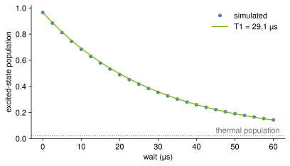
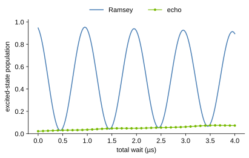

..
   SPDX-FileCopyrightText: Copyright (c) 2026 NVIDIA CORPORATION & AFFILIATES. All rights reserved.
   SPDX-License-Identifier: Apache-2.0

Coherence: T1, Ramsey and Echo
==============================

A qubit forgets in two ways: it relaxes from the excited state, and its phase
drifts away from the drive's. This tutorial measures both on the simulated
qubit from :doc:`first_pulse_program`. You'll use the quantum system's
calibrated π and π/2 pulses, sweep a wait whose length is a kernel argument,
fit T1, and watch a spin echo cancel a detuning that a Ramsey sequence
records.

What the model knows
--------------------

Each qudit of a quantum system carries its measured coherence times, along
with the pulses its gates are calibrated for:

.. code-block:: python

   import numpy as np

   import cudaq_pulse as pulse

   qs = pulse.quantum_system("transmon_surface17")
   q = qs.qudits[0]
   d1 = qs.physical_qudits[0]

   print(d1.label, d1.t1_us, d1.t2_star_us, d1.t2_echo_us)   # D1 29.1 35.0 46.2
   print(q.get_calibration(pulse.gates.X))   # DragPulse(duration_ns=40.0, sigma_ns=10.0, amplitude=0.1313058652516393, beta_ns=0.5138649945351855)

The first qubit, labelled D1, has a T1 of 29.1 µs, a Ramsey dephasing time
T2* of 35.0 µs and an echo time of 46.2 µs. Its π pulse is a 40 ns DRAG pulse,
the Gaussian shape with a small correction in the other quadrature that keeps
a transmon out of its third level. Simulation includes the relaxation and
dephasing these times describe.

Measure T1
----------

Excite the qubit, wait, then read it out. The longer the wait, the more of
the excitation has decayed:

.. code-block:: python

   @pulse.kernel
   def t1(qudit, wait_ns: float):
       d = get_drive_line(qudit)
       r = get_readout_line(qudit)
       drive(d, d.get_calibration(pulse.gates.X))   # the calibrated π pulse
       wait(d, wait_ns * pulse.ns)
       sync(d, r)
       return readout(r, r.get_calibration(pulse.gates.READOUT))

``d.get_calibration(pulse.gates.X)`` is the line's calibrated π pulse, and
``r.get_calibration(pulse.gates.READOUT)`` its readout pulse, so the kernel
holds no pulse parameters of its own. The wait length comes from a ``float``
argument, which keeps it a parameter of the compiled program: a sweep over
it compiles once.

.. code-block:: python

   waits = np.linspace(0, 60_000, 7)   # nanoseconds
   populations = [pulse.simulate(t1, q, w).level_population(1) for w in waits]
   print([round(p, 3) for p in populations])   # [0.968, 0.686, 0.491, 0.355, 0.259, 0.191, 0.143]
   print(t1.cache_info().compiled)   # 1

The excited-state population falls toward the qubit's thermal population
of 2.1%, not toward zero, because the model's qubit sits in a slightly warm
environment. Subtract it and the decay is a straight line on a log scale,
whose slope gives T1:

.. code-block:: python

   excess = np.array(populations) - d1.thermal_population
   slope = np.polyfit(waits, np.log(excess), 1)[0]
   print(round(-1 / slope / 1000, 1))   # 29.3, the fitted T1 in µs

The fit gives 29.3 µs against the model's 29.1 µs. The small difference
comes from the readout pulse: the qubit keeps decaying while it is measured.

   Excited-state population after each wait, with the exponential decay the
   model's T1 predicts.

Ramsey fringes
--------------

A Ramsey sequence puts the qubit on the equator with a π/2 pulse, lets it
precess, and turns it back with a second π/2 pulse. If the drive is detuned
from the qubit, the phase that builds up during the wait shows up as
fringes. ``shift_frequency`` detunes the drive's tone by 1 MHz:

.. code-block:: python

   @pulse.kernel
   def ramsey(qudit, tau_ns: float):
       d = get_drive_line(qudit)
       r = get_readout_line(qudit)
       x90 = d.get_calibration(pulse.gates.X90)
       shift_frequency(d.tone, 1e6)   # detune the drive by 1 MHz
       drive(d, x90)
       wait(d, tau_ns * pulse.ns)
       drive(d, x90)
       sync(d, r)
       return readout(r, r.get_calibration(pulse.gates.READOUT))

   taus = np.linspace(0, 4_000, 41)
   fringes = [pulse.simulate(ramsey, q, tau).level_population(1) for tau in taus]
   revival = taus[5 + int(np.argmax(fringes[5:15]))]   # the first maximum after tau = 0
   print(revival)   # 1000.0, one fringe per microsecond

The population returns to its maximum after 1 µs, the period of the 1 MHz
detuning. Over a few microseconds the fringes barely shrink, since T2* is
35 µs; their slow loss of contrast over a longer sweep is what a Ramsey
measurement of T2* fits.

Cancel the detuning with an echo
--------------------------------

A π pulse halfway through the wait reverses the phase the qubit has
gathered, so in the second half it unwinds again. Any detuning that stays
the same during the sequence cancels:

.. code-block:: python

   @pulse.kernel
   def echo(qudit, tau_ns: float):
       d = get_drive_line(qudit)
       r = get_readout_line(qudit)
       x90 = d.get_calibration(pulse.gates.X90)
       shift_frequency(d.tone, 1e6)
       drive(d, x90)
       wait(d, tau_ns / 2 * pulse.ns)
       drive(d, d.get_calibration(pulse.gates.X))   # the refocusing π pulse
       wait(d, tau_ns / 2 * pulse.ns)
       drive(d, x90)
       sync(d, r)
       return readout(r, r.get_calibration(pulse.gates.READOUT))

   echoes = [pulse.simulate(echo, q, tau).level_population(1) for tau in taus[::5]]
   print([round(p, 3) for p in echoes])   # [0.022, 0.031, 0.035, 0.047, 0.048, 0.055, 0.061, 0.074, 0.073]

The three pulses add up to a full turn, so the qubit ends close to its
ground state for every wait, with no fringes. What's left is a slow rise
from decay and dephasing during the wait, which an echo measurement of T2
fits.

   With a 1 MHz detuning, the Ramsey sequence oscillates once per
   microsecond. The echo refocuses the detuning and stays near the ground
   state.

Where to go next
----------------

- :example:`03_t1_t2_dissipator.py` compares a T1 sweep with the decay the
  model predicts, and compiles Ramsey and echo kernels with their own DRAG
  pulses.
- :example:`04_hahn_echo.py` builds the Hahn echo and a CPMG train of echo
  pulses.
- :example:`13_dynamical_decoupling.py` spaces many refocusing pulses as XY4,
  CPMG and Uhrig sequences.
- :example:`20_adaptive_calibration.py` picks each wait from the last
  measurement to track a drifting qubit, which :doc:`adaptive_calibration`
  walks through.

:doc:`../user_guide/kernels` describes waits whose length is a parameter,
and :doc:`../user_guide/quantum_systems` how a quantum system stores its
coherence times and calibrations.
