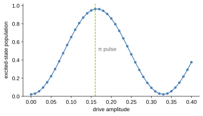
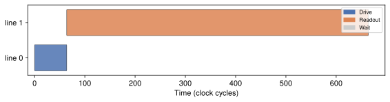

..
   SPDX-FileCopyrightText: Copyright (c) 2026 NVIDIA CORPORATION & AFFILIATES. All rights reserved.
   SPDX-License-Identifier: Apache-2.0

Your First Pulse Program
========================

This tutorial goes from installing CUDA-Q Pulse to a simulated Rabi
oscillation on one transmon qubit. You write one short pulse program, run it
against a model of a 17-qubit superconducting processor, and sweep the drive
amplitude until the qubit flips. Everything here runs on a laptop CPU, with
no GPU or quantum hardware.

Install
-------

CUDA-Q Pulse needs Python 3.12 or newer, on Linux or macOS. Install it in a
virtual environment:

.. code-block:: bash

   python -m venv .venv
   source .venv/bin/activate
   pip install cudaq-pulse
   python -m cudaq_pulse.doctor

The doctor lists what was installed and checks that it works. Without a CUDA
extra it ends with ``Result: OK, compilation and CPU simulation work; GPU
simulation is not set up.``, which is all this tutorial needs: every step
runs on the CPU. :doc:`../getting_started` lists the supported platforms and
the GPU extras.

Pick a quantum system
---------------------

A pulse program runs on a *quantum system*: the calibrated physics of a
machine, with each qudit's frequencies and coherence times, the couplings
between qudits, and the clock that pulses are timed against. CUDA-Q Pulse
ships a model of a 17-qubit superconducting processor built for a
distance-3 surface code. This tutorial uses its first qubit:

.. code-block:: python

   import cudaq_pulse as pulse

   qs = pulse.quantum_system("transmon_surface17")
   q = qs.qudits[0]

   print(q)                       # <Qudit 0 -> qudit 0 of transmon_surface17>
   print(qs.qudit_freq[0] / 1e9)  # 3.885, its 0-1 transition in GHz
   print(qs.clock_ghz)            # 2.0

CUDA-Q Pulse calls ``q`` a qudit because a transmon has more than two
levels. The simulator keeps the lowest three, so a pulse that drives too
hard shows up as population in level 2.

Write a pulse kernel
--------------------

A pulse program is a Python function with the ``@pulse.kernel`` decorator.
Each qudit has a drive line, which carries the microwave pulses that rotate
it, and a readout line, which measures it. This kernel plays one pulse on the
drive line and then reads the qubit out:

.. code-block:: python

   @pulse.kernel
   def rabi(qudit, amplitude: float):
       d = get_drive_line(qudit)     # the line that drives the qudit
       r = get_readout_line(qudit)   # the line that reads it out
       x = gaussian(duration=32 * pulse.ns, amplitude=amplitude,
                    sigma=8 * pulse.ns)
       drive(d, x)
       sync(d, r)    # start the readout after the drive pulse ends
       return readout(r, square(300 * pulse.ns, 0.05))

The drive is a Gaussian pulse 32 ns long, 8 ns wide, at an amplitude you
choose for each call. ``sync`` lines the two lines up, so the 300 ns readout
pulse starts when the drive pulse ends, and the kernel returns the readout's
outcome.

Inside a kernel, ``drive``, ``gaussian`` and the other operations are used
by their bare names, and editors that use Pylance or pyright complete and
check them with no setup (see :doc:`../user_guide/editors`). Durations carry
units, so the same kernel runs unchanged on a quantum system with another
clock.

Simulate it
-----------

``pulse.simulate`` compiles the kernel for the qudit's quantum system and
evolves it on the CPU, with the qubit's relaxation and dephasing included:

.. code-block:: python

   result = pulse.simulate(rabi, q, 0.16)
   levels = result.level_populations(q)
   print([round(p, 3) for p in levels])   # [0.036, 0.963, 0.001]

These are the populations of levels 0, 1 and 2 at the end of the program.
At amplitude 0.16 the pulse is close to a π pulse, and 96% of the
population ends up in the excited state. The rest comes from the model's
physics: the qubit starts in a thermal mixture with about 2% already
excited, which the pulse flips the other way, and it relaxes a little during
the 300 ns readout.

Sweep the amplitude
-------------------

A Rabi experiment repeats the program over a range of amplitudes:

.. code-block:: python

   import numpy as np

   amplitudes = np.linspace(0, 0.4, 41)
   populations = []
   for a in amplitudes:
       result = pulse.simulate(rabi, q, a)
       populations.append(result.level_population(1))

   print(rabi.cache_info().compiled)   # 1

Because ``amplitude`` is annotated ``float``, it stays a parameter of the
compiled program instead of being fixed into it. The 41 simulations share
one compilation, which ``cache_info`` confirms.

   The excited-state population after the pulse, for each amplitude. It
   peaks at 0.16, the π pulse, and returns close to zero near 0.33, a full
   rotation.

Take shots
----------

A simulation gives probabilities, while an experiment gives one outcome per
shot. Ask for shots and the simulator samples them from the same evolution:

.. code-block:: python

   result = pulse.simulate(rabi, q, 0.16, shots_count=1000, seed=7)
   outcomes = np.asarray(result.records)
   print(outcomes.shape)    # (1000, 1)
   print(outcomes.mean())   # 0.956

``result.records`` holds one row per shot and one column per readout, here
the kernel's single readout. The fraction of shots that read 1 matches the
excited-state population above, within sampling error.

See what was compiled
---------------------

``lower`` compiles and schedules a call without running it, so you can see
when each pulse plays:

.. code-block:: python

   scheduled = rabi.lower(q, 0.16)
   for event in scheduled.schedule:
       print(event.kind, event.start_cycles, event.duration_cycles)
   # drive 0 64
   # readout 64 600

Times in a schedule count cycles of the quantum system's 2 GHz clock. The
32 ns drive pulse is 64 cycles, and the readout starts at cycle 64, where
``sync`` put it. ``scheduled.timeline()`` draws the schedule with matplotlib,
which the ``[viz]`` extra installs (``pip install "cudaq-pulse[viz]"``):

.. code-block:: python
   :class: viz

   figure = scheduled.timeline()
   figure.savefig("rabi_schedule.svg")

   The schedule of one call. Line 0 is the qubit's drive line and line 1 its
   readout line.

``print(scheduled.mlir())`` shows the same program as MLIR in the Pulse
dialect, the form that compiler passes, simulators and controller backends
read. Each ``pulse.drive`` and ``pulse.readout`` in it carries the start and
duration in cycles listed above. You don't need to read MLIR to use CUDA-Q
Pulse, but it's there when you want to check what the compiler did;
:doc:`../architecture/dialects` describes it.

Where to go next
----------------

Each of these examples takes one idea from this page further, as a complete
script you can run from a clone of the repository with
``python examples/<file>``:

- :example:`01_single_qubit_rabi.py` sweeps a square pulse instead of a
  Gaussian, and compiles the same kernel for a quantum system with a 1 GHz
  clock.
- :example:`03_t1_t2_dissipator.py` lets the qubit decay for a range of
  waits and compares the simulated T1 decay with the exponential the model
  predicts, alongside Ramsey and Hahn-echo kernels.
- :example:`08_readout_and_branching.py` reads out IQ data and branches on a
  measurement result, as in an active reset that plays a π pulse only when
  the qubit reads 1.
- :example:`16_visualization.py` draws the schedules of a three-qubit
  program under two scheduling policies.
- :example:`transmon/transmon_surface17_rabi.py` drives qubit D5 of the same
  quantum system with its calibrated π pulse and follows the program down to
  the operator form the simulator evolves.

The next tutorial, :doc:`coherence`, uses the quantum system's calibrated
pulses to measure T1 and dephasing. :doc:`../examples` lists every example.
For the details behind this page,
:doc:`../user_guide/kernels` covers what a kernel can contain,
:doc:`../user_guide/quantum_systems` how quantum systems are described and
calibrated, and :doc:`../user_guide/compilation` how calls compile and what
they return.
