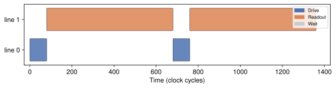

..
   SPDX-FileCopyrightText: Copyright (c) 2026 NVIDIA CORPORATION & AFFILIATES. All rights reserved.
   SPDX-License-Identifier: Apache-2.0

Measure and React
=================

A readout is more than the end of a program. Its outcome can decide what the
program plays next, during the same shot. This tutorial reads out a qubit in a
superposition, takes shots, and then writes an active reset: measure, and
play a π pulse only if the qubit was found excited. Along the way you'll see
how the simulator follows both outcomes of a measurement at once.

Outcomes and shots
------------------

Put the qubit halfway between its two states with a π/2 pulse, then read it
out:

.. code-block:: python

   import numpy as np

   import cudaq_pulse as pulse

   qs = pulse.quantum_system("transmon_surface17")
   q = qs.qudits[0]

   @pulse.kernel
   def measure_superposition(qudit):
       d = get_drive_line(qudit)
       r = get_readout_line(qudit)
       drive(d, d.get_calibration(pulse.gates.X90))
       sync(d, r)
       return readout(r, r.get_calibration(pulse.gates.READOUT))

   result = pulse.simulate(measure_superposition, q, shots_count=1000, seed=7)
   records = np.asarray(result.records)   # one row per shot, one column per readout
   print(records[:5].ravel().tolist())   # [1, 0, 0, 1, 1]
   print(records.mean())   # 0.496

Each row of ``records`` is one shot and each column one readout. About half
of the shots read 1, as a π/2 pulse should give. The ``seed`` makes the
sampled shots repeatable.

Branch on the outcome
---------------------

An ``if`` on a readout's result stays in the compiled program as a branch
that the controller takes during the shot. This kernel resets the qubit to
its ground state whatever it started in, then reads it out a second time to
check:

.. code-block:: python

   @pulse.kernel
   def active_reset(qudit):
       d = get_drive_line(qudit)
       r = get_readout_line(qudit)
       drive(d, d.get_calibration(pulse.gates.X90))
       sync(d, r)
       outcome = readout(r, r.get_calibration(pulse.gates.READOUT))
       sync(d, r)
       if outcome:
           drive(d, d.get_calibration(pulse.gates.X))   # found excited: flip it back
       sync(d, r)
       return readout(r, r.get_calibration(pulse.gates.READOUT))

   result = pulse.simulate(active_reset, q, shots_count=1000, seed=7)
   records = np.asarray(result.records)
   print([round(float(m), 3) for m in records.mean(axis=0)])   # [0.496, 0.002]
   print(round(result.level_population(0), 3))   # 0.999

The first readout reads 1 in about half of the shots, and the second reads 1
in fewer than one shot in 300: the reset works whichever outcome came first.
At the end, 99.9% of the population is in the ground state.

How the simulator follows both outcomes
---------------------------------------

The simulator doesn't pick one outcome per shot and run the program again.
It follows every outcome of every readout, each as a *branch* with its
probability, and samples the shots from those branches afterwards:

.. code-block:: python

   for branch in result.branches:
       if branch.probability > 0.01:
           print(branch.levels, round(branch.probability, 3))
   # (0, 0) 0.505
   # (1, 0) 0.494

``levels`` holds what each readout found along that branch. Both likely
branches end with a second readout of 0. The small branches the loop skips
hold the rare paths: a qubit that decayed or leaked to level 2 during a
readout. Because every branch is followed, the final state is the exact
average over shots, not an estimate from a sample.

See the branch in the schedule
------------------------------

The scheduler places the conditional pulse where it would play, after the
first readout ends:

.. code-block:: python

   scheduled = active_reset.lower(q)
   for event in scheduled.schedule:
       print(event.kind, event.start_cycles, event.duration_cycles)
   # drive 0 80
   # readout 80 600
   # drive 680 80
   # readout 760 600

The drive at cycle 680 plays only on shots whose first readout found the
qubit excited. On the other shots its line idles for the same 80 cycles, so
the second readout starts at cycle 760 either way and the program's timing
doesn't depend on the outcome.

   The schedule of the active reset. The second drive pulse plays only when
   the first readout reads 1.

Where to go next
----------------

- :example:`08_readout_and_branching.py` prints the MLIR of a readout and of
  the active reset's branch, and simulates the reset from an equal
  superposition.
- :example:`12_error_detection.py` shows what the verifier reports for
  intentionally malformed Pulse MLIR.
- :example:`25_precompiled_branches.py` compiles the next program of an
  adaptive experiment for each outcome ahead of time.
- :example:`19_classical_calls.py` sends a readout to a classical function and
  branches on its answer, which :doc:`classical_calls` introduces.

:doc:`../user_guide/kernels` lists which conditions a branch can test, and
:doc:`../user_guide/compilation` what a kernel call returns.
