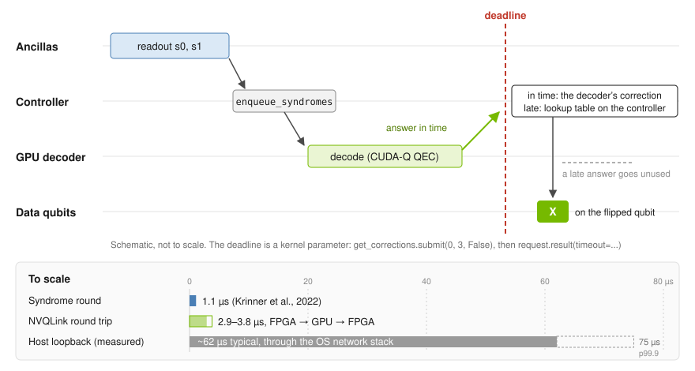

..
   SPDX-FileCopyrightText: Copyright (c) 2026 NVIDIA CORPORATION & AFFILIATES. All rights reserved.
   SPDX-License-Identifier: Apache-2.0

Real-Time Decoding with a Deadline
==================================

Quantum error correction measures syndromes, decodes them into corrections,
and applies the corrections, round after round. Done in real time, the
decoder has to answer while the qubits wait, and the program needs a plan
for the shots where it doesn't. This tutorial runs one round of a distance-3
repetition code: it reads out two ancillas, asks a decoder for corrections
with a deadline, and falls back to a lookup table on the controller when the
answer is late.

The code and its syndrome
-------------------------

Three data qubits hold one logical bit, and two ancillas hold the syndrome:
the parity of data qubits 0 and 1, and of 1 and 2. A single bit flip shows
up as a unique syndrome, which says which qubit to flip back:

.. list-table::
   :header-rows: 1

   * - Syndrome (s0, s1)
     - Flipped data qubit
   * - (0, 0)
     - none
   * - (1, 0)
     - 0
   * - (1, 1)
     - 1
   * - (0, 1)
     - 2

The decoder below answers with that table. A real decoder, such as the one
in the last section, does the same job for codes where no table fits in the
controller's memory.

.. code-block:: python

   import numpy as np

   import cudaq_pulse as pulse

   def lookup(syndrome: pulse.Bits) -> pulse.Bits:
       s0, s1 = syndrome[0], syndrome[1]
       return [s0 & (1 - s1), s0 & s1, s1 & (1 - s0)]   # one correction bit per data qubit

   # Corrections come back in about 62 us, and 75 us at worst.
   decode = pulse.classical(lookup, link="gpu", nominal_latency_ns=62_000, max_latency_ns=75_000)

``pulse.classical`` declares a function you already have, here ``lookup``,
as well as decorating a new one. That makes it easy to declare the same
function again with another budget, as the simulation below does.

The latencies are round trips measured from a host process to a decoding
server on a GPU in the same workstation, over the network stack. On NVQLink,
requests travel from the controller to the GPU without the host, in a few
microseconds.

One round, with a deadline
--------------------------

.. code-block:: python

   @pulse.kernel
   def qec_round(data, ancillas, deadline_ns: int):
       # ... syndrome-extraction pulses on data and ancillas go here ...
       s0 = readout(get_readout_line(ancillas[0]), square(400 * pulse.ns, 0.05))
       s1 = readout(get_readout_line(ancillas[1]), square(400 * pulse.ns, 0.05))

       in_time, fix = decode.submit([s0, s1]).result(timeout=deadline_ns * pulse.ns)

       table = [s0 and not s1, s0 and s1, s1 and not s0]   # the fallback, on the controller
       for i in range(3):
           flip = fix[i] if in_time else table[i]
           if flip:
               drive(get_drive_line(data[i]), square(20 * pulse.ns, np.pi / 20))   # a π pulse

The deadline is a kernel argument, so you can trade waiting against falling
back without editing the program. The syndrome-extraction pulses are left
out: the shipped transmon models schedule a CZ as an idle slot, since flux
pulses aren't simulated yet, so the round starts from the state extraction
leaves.

Compiling checks the timing before anything runs:

.. code-block:: python

   qs = pulse.quantum_system("transmon_lattice:5")   # five transmons in a row
   data, ancillas = qs.qudits[0:3], qs.qudits[3:5]
   control_system = pulse.ControlSystem(links={"gpu": pulse.Link(feedback_ns=50)})
   compiled = pulse.compile(qec_round, quantum_system=qs, control_system=control_system)

   call = compiled.lower(data, ancillas, 80_000).classical_report()[0]
   print(call.due_cycles / qs.clock_ghz)   # 80450.5, when the answer is due, in ns

With an 80 µs deadline, the answer is due after the 400 ns readouts, the
80 µs wait and the link's 50 ns, and the corrections are scheduled after it.

   One round of ``qec_round``. The correction plays from the decoder's
   answer if it arrives by the deadline, or from the controller's lookup
   table if it doesn't.

Simulate both arms
------------------

Start from the state syndrome extraction leaves: no error, or one flipped
data qubit, each with a quarter of the probability, with the ancillas
holding the matching syndrome. Then check how often the data qubits end
back in 000:

.. code-block:: python

   def start_state():
       state = np.zeros(2**5)
       for bits in [(0, 0, 0, 0, 0), (1, 0, 0, 1, 0), (0, 1, 0, 1, 1), (0, 0, 1, 0, 1)]:
           state[sum(b << k for k, b in enumerate(bits))] = 0.5   # data 0-2, then ancillas
       return state

   def run(program):
       result = pulse.simulate(program, initial_state=start_state(), levels=2, latency_branching=True, dt_ns=2.0)
       used = sum(b.probability for b in result.branches if b.calls and b.calls[-1].in_time)
       restored = sum(result.density_matrix[i, i].real for i in range(32) if i & 0b111 == 0)
       return round(float(used), 3), round(float(restored), 3)

   print(run(compiled.lower(data, ancillas, 1_000)))   # (0.0, 0.883)

With a 1 µs deadline, the decoder's 62 µs answer is always late, so the
table makes every correction, and 88.3% of the population is back in 000.
The rest decays during the round. Now give the decoder a budget that fits:

.. code-block:: python

   decode = pulse.classical(lookup, link="gpu", max_latency_ns=500)
   fast = pulse.compile(qec_round, quantum_system=qs, control_system=control_system)
   print(run(fast.lower(data, ancillas, 1_000)))   # (1.0, 0.883)

Compiling again picks up the new declaration, since a kernel reads the
functions it calls when it compiles. Every shot now uses the decoder's
answer, and the data qubits are restored
equally often: the table and the decoder agree on every single-qubit error.
That agreement is what makes the fallback safe, and checking it in
simulation, before a program runs on hardware, is the point of the exercise.

With a CUDA-Q QEC decoder
-------------------------

`CUDA-Q QEC <https://nvidia.github.io/cudaq-qec/>`_ provides GPU decoders and
their real-time functions. ``pulse.classical`` takes those functions as
they are, with a link and a latency budget, and the kernel calls them as it
called ``decode``. This needs Linux, an NVIDIA GPU, Python 3.12 or 3.13, and
``pip install cudaq-qec``; the test suite runs it only there.

.. code-block:: python
   :class: cudaq-qec

   import cudaq_qec

   # Decoder 0: BP+OSD on the GPU for the distance-3 repetition code.
   cudaq_qec.configure_decoders_from_str("""
   decoders:
     - id: 0
       type: nv-qldpc-decoder
       block_size: 3
       syndrome_size: 2
       H_sparse: [0, 1, -1, 1, 2, -1]
       O_sparse: [0, -1, 1, -1, 2, -1]
       D_sparse: [0, -1, 1, -1]
       decoder_custom_args:
         error_rate_vec: [0.1, 0.1, 0.1]
         use_sparsity: true
         max_iterations: 50
         use_osd: true
         osd_method: 3
         osd_order: 7
   """)

   enqueue_syndromes = pulse.classical(cudaq_qec.qec.enqueue_syndromes, link="gpu")
   get_corrections = pulse.classical(
       cudaq_qec.qec.get_corrections, link="gpu", nominal_latency_ns=62_000, max_latency_ns=75_000
   )

   @pulse.kernel
   def qec_round_with_cudaq_qec(data, ancillas, deadline_ns: int):
       s0 = readout(get_readout_line(ancillas[0]), square(400 * pulse.ns, 0.05))
       s1 = readout(get_readout_line(ancillas[1]), square(400 * pulse.ns, 0.05))
       enqueue_syndromes.submit(0, [s0, s1], 0)   # decoder 0, round 0
       in_time, fix = get_corrections.submit(0, 3, False).result(timeout=deadline_ns * pulse.ns)
       table = [s0 and not s1, s0 and s1, s1 and not s0]
       for i in range(3):
           flip = fix[i] if in_time else table[i]
           if flip:
               drive(get_drive_line(data[i]), square(20 * pulse.ns, np.pi / 20))

   decoded = pulse.compile(qec_round_with_cudaq_qec, quantum_system=qs, control_system=control_system)
   print(run(decoded.lower(data, ancillas, 1_000)))
   cudaq_qec.finalize_decoders()

On hardware, these requests are the messages of CUDA-Q QEC's decoding
server; in simulation, the configured decoder answers them in the same
process.

Where to go next
----------------

- :example:`27_realtime_decoding.py` runs this round end to end with the
  CUDA-Q QEC decoder, asks it for each syndrome's correction from the host,
  and compares both arms with no correction at all.
- :example:`19_classical_calls.py` covers decoding with feed-forward, call
  slack and hidden latency.
- :example:`18_per_kernel_schedules.py` schedules a surface-code-style
  stabilizer cycle with dynamical decoupling.
- :example:`transmon/transmon_surface17_surface_code_cycle.py` lays out one
  error-correction cycle of the 17-qubit surface code.

:doc:`../user_guide/classical_calls` describes the decoder messages, emulation
in virtual time, and how a late answer is reported.
